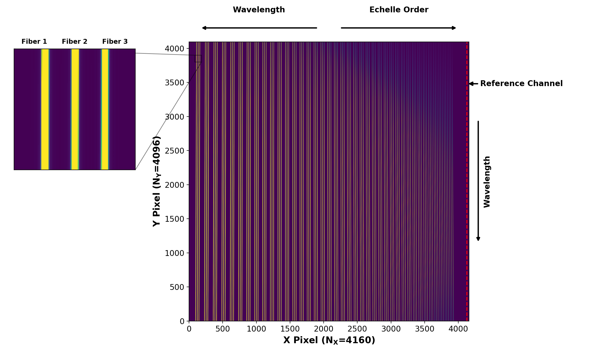
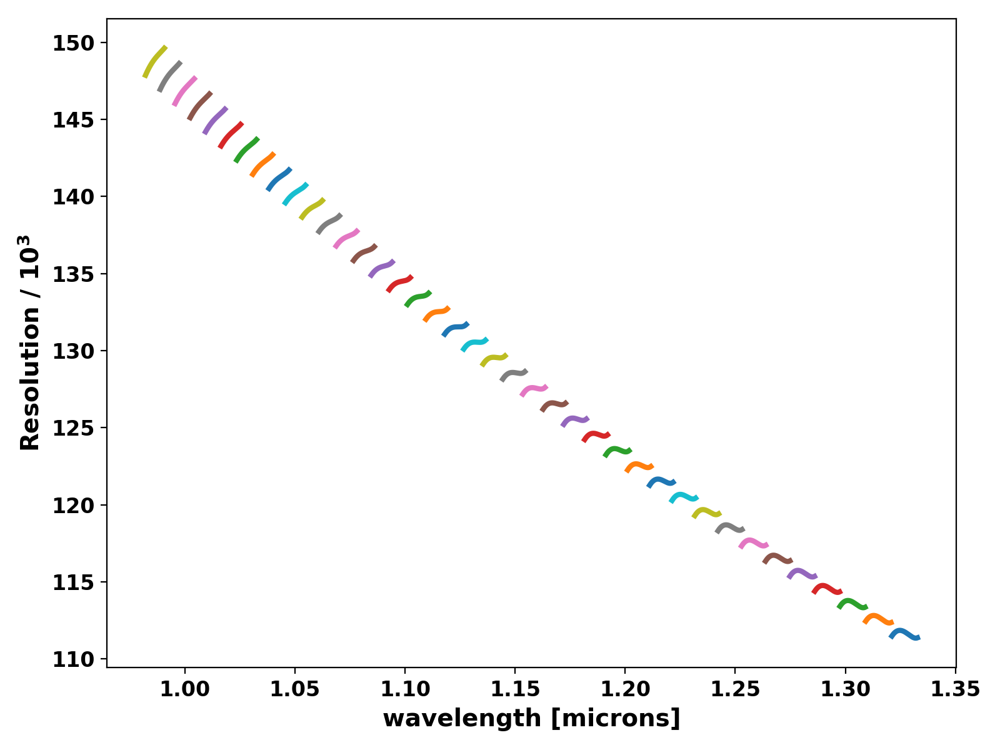
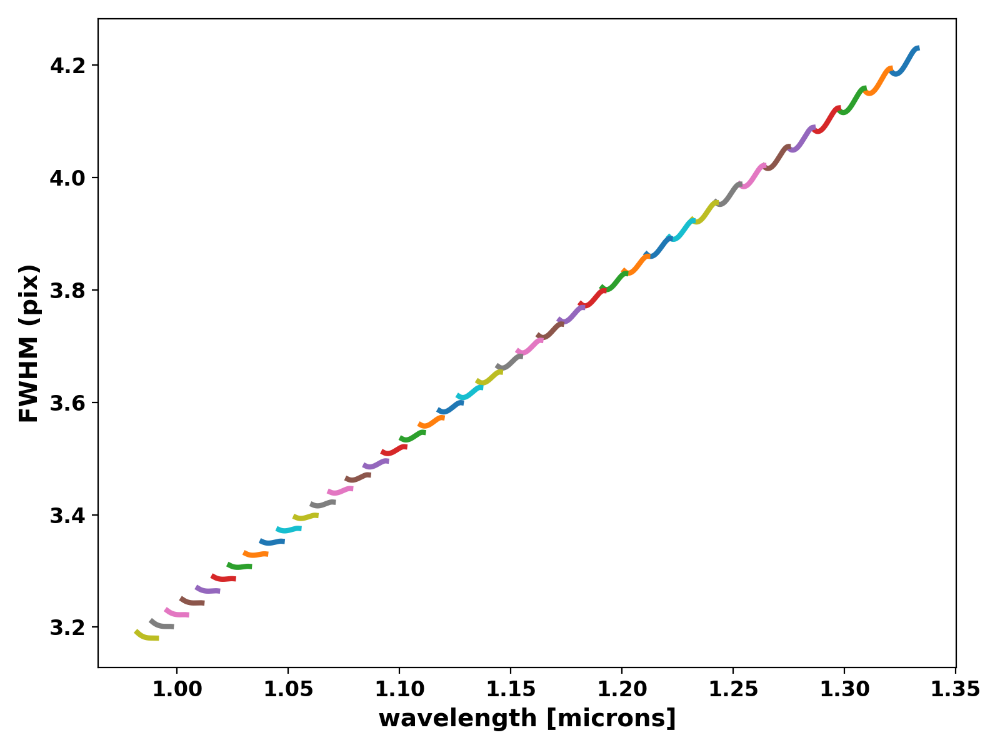

==================
HISPEC Data Format
==================

HISPEC has two spectrographs:

- BSPEC: Blue Spectrograph, which covers the Y and J bands (0.98 - 1.327 μm).

- RSPEC: Red Spectrograph, which covers the H and K bands (1.49 - 2.46 μm).

HISPEC Echellogram Layout
+++++++++++++++++++++++++

- Fibers are named 1, 2, and 3 from left to right when viewing the echellogram with orders oriented vertically and the red end of the spectrum on the right.

- Individual fibers are spectrally shifted with respect to each other for the same detector row. For BSPEC, fibers 2 and 3 are shifted by ~ -63 km/s and -126 km/s, respectively, relative to fiber 1. For RSPEC, fibers 2 and 3 are shifted by ~ -79 km/s and -158 km/s, respectively, relative to fiber 1.

- Level 0 data (rate maps) include the reference channel (65th channel) which has pixels insensitive to light and can be further used to characterize and diagnose detector systematics.

- LFC modes are labeled according to the formula :math:`\nu_{n} = \nu_{0} + n \Delta\nu` where :math:`\nu_{0}` is the frequency of the LFC pump line, :math:`\Delta\nu` is the comb line spacing (constant in frequency), and :math:`n` is the mode number. Therefore, The LFC mode number :math:`n` is anti-correlated with wavelength.

BSPEC
+++++

BSPEC data has 39 orders (:math:`m=110-148`) and covers the Y and J bands (:math:`0.98 - 1.327\ \mu \mathrm{m}`). Additional parameters for each BSPEC order are shown below.

The spectral resolutions and FWHM values provided below are measured from laser frequency comb lines *as sampled on the detector*, (e.g., from the effective line spread function). Due to the pixel response function (assumed to be top-hat), this results in an additional loss in resolution due to the pixel response function, and an apparent increase in sampling (both ~5%).

.. csv-table::
   :file: ../_static/data/hispec_bspec_orders.csv
   :header-rows: 1
   :widths: auto

**BSPEC Spectral Resolution**

**BSPEC Spectral Sampling**

RSPEC
+++++

Under development.