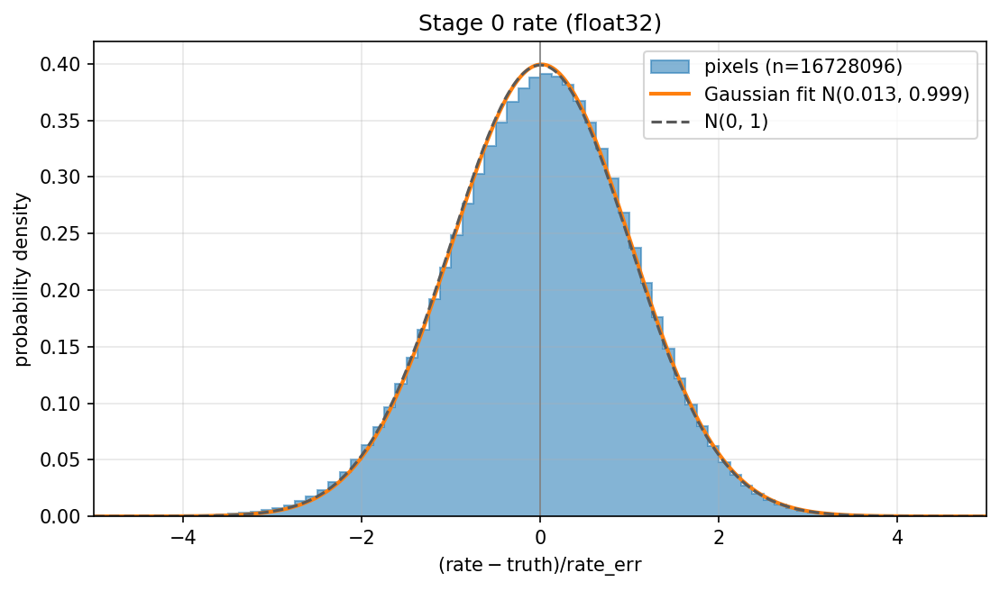
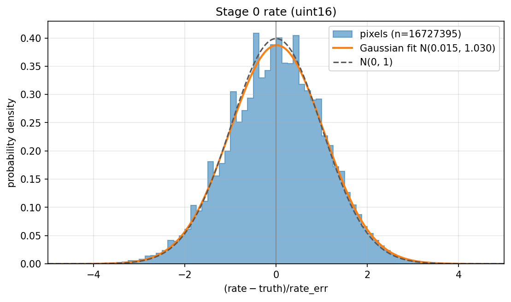

Stage 0 Rate Noise Self-Check
=============================

Testing a realistic UTR in the Stage 0 pipeline to verify that we can recover
the injected rate to within the typical uncertainty of the reported
``rate_err``. This example displays ``(rate − truth) / rate_err`` with a
Gaussian fit overlay. The test is performed twice, using an ideal ``float32``
UTR and again with a realistic ``uint16`` UTR.

.. raw:: html

   
The HISPEC DRP is in active development. Please submit issues and suggestions on the <a href="https://github.com/oirlab/HISPEC_DRP">GitHub</a>.

.. raw:: html

   

     <a class="download-notebook-btn"
        href="../../_static/notebooks/stage0_rate_noise_selfcheck.ipynb"
        data-notebook-download="stage0_rate_noise_selfcheck.ipynb"
        download="stage0_rate_noise_selfcheck.ipynb">Download as notebook</a>
   

.. warning::
   **Setup.** Set these in your shell / notebook kernel before running (or let
   the first cell create a local cache under ``OUT``):

.. list-table::
   :header-rows: 1
   :widths: 28, 28, 44

   * - Variable
     - Required when
     - Purpose
   * - ``KOA_CALIBRATION_CACHE``
     - Always
     - Local KOA calibration cache directory (and SQLite DB)
   * - ``KECK_OBSERVER_EMAIL``
     - Optional remote sync
     - Keck Observer account email
   * - ``KECK_OBSERVER_PASSWORD``
     - Optional remote sync
     - Keck Observer account password

Imports and output directory
----------------------------

.. code-block:: python

   import os
   import hispecdrp

   OUT = "/path/to/stage0_rate_noise_selfcheck"
   os.makedirs(OUT, exist_ok=True)
   os.environ.setdefault(
       "KOA_CALIBRATION_CACHE",
       os.path.join(OUT, "cals", "KOA_CALIBRATION_CACHE"),
   )
   print(f"OUT={OUT}")

1. KOA caldb
------------

Calibrations are downloaded for this step as the simulator
``create_ramp_from_spectrum`` below can use realistic calibrations stored on
KOA.

.. code-block:: python

   from hispecdrp.calibrations import verify_koa_calibrations

   SPECTROGRAPH = "BSPEC"
   summary = verify_koa_calibrations(
       SPECTROGRAPH, ignore_missing_cal_types=["lfc_wavesol"]
   )
   print(f"{summary['spectrograph']}: {summary['n_records']} records")

2. Simulate float32 / uint16 UTRs
---------------------------------

.. code-block:: python

   import numpy as np
   from hispecdrp import datamodels
   from hispecdrp.simulations.simulate_up_the_ramp import create_ramp_from_spectrum

   FIBERS = [2]
   N_READS = 10
   SEED = 0

   ramp_float32, cals, rate_map = create_ramp_from_spectrum(
       OUT,
       spectrograph=SPECTROGRAPH,
       fibers=FIBERS,
       template_filename="lte049.0-2.5-0.0a+0.0.BT-Settl.spec.7.h5",
       mag_ab=3.05,
       filter_band="J",
       n_reads=N_READS,
       seed=SEED,
       poisson_noise=True,
       convert_to_uint16=False,
       clip_ramps=True,
       use_master_calibrations=True,
       ramp_filename="simulated_ramp_float32.fits",
       overwrite_ramp=True,
   )

   u16 = np.clip(np.round(ramp_float32.data), 0, np.iinfo(np.uint16).max).astype(np.uint16)
   meta_u16 = dict(ramp_float32.meta)
   meta_u16["filename"] = "simulated_ramp_uint16.fits"
   ramp_uint16 = datamodels.RampModel(
       data=u16,
       dq_raw=np.asarray(ramp_float32.dq_raw).copy(),
       meta=meta_u16,
   )
   ramp_uint16.save(filepath=os.path.join(OUT, ramp_uint16.meta.filename))
   ramps = {"float32": ramp_float32, "uint16": ramp_uint16}
   print(f"Stage-0 cals: {sorted(cals)}")
   print(f"nonlin note: {getattr(getattr(cals.get('nonlin'), 'meta', None), 'note', None)}")

3. Stage 0
----------

This cell will call the Stage0Pipeline for the ``uint16`` and ``float32`` UTR
frames with: ``Stage0Pipeline.call(ramp, output_dir=OUT)`` using all default
pipeline arguments. Products will be stored under ``OUT``.

.. code-block:: python

   from hispecdrp.pipelines import Stage0Pipeline

   l0s = {
       label: Stage0Pipeline.call(ramp, output_dir=OUT)
       for label, ramp in ramps.items()
   }

4. Histograms of recovered versus injected rate levels
------------------------------------------------------

``(rate − truth) / rate_err`` with a Gaussian fit demonstrating that the
pipeline can recover a rate map resembling the injected value. After subtracting
the injected value and normalizing by the recovered error map, we should see a
normal distribution of pixels with a mean of 0 and unit variance.

.. code-block:: python

   from hispecdrp.simulations.plotting import plot_stage0_rate_pull_histogram

   for label, l0 in l0s.items():
       plot_stage0_rate_pull_histogram(
           l0.rate,
           l0.rate_err,
           rate_map,
           dq=l0.dq,
           error_mode="fit",
           title=f"Stage 0 rate ({label})",
           print_stats=False,
       )

   Histograms of recovered versus injected rate levels for the ideal
   ``float32`` UTR (``(rate − truth) / rate_err`` with Gaussian fit).

   Same check for the realistic ``uint16`` UTR.
