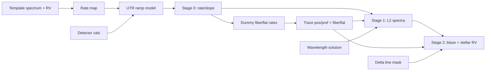

# End-to-End Simulation Notes

The end-to-end (E2E) simulation exercises HISPEC DRP from a known input stellar template through a synthetic up-the-ramp (UTR) detector readout, full Stage 0–2 reduction, and a radial-velocity (RV) estimate. It is intended as a realistic forward model—incorporating target spectrum, instrument trace/PSF geometry, detector noise, and (optionally) archival master calibrations—for assessing pipeline performance, recovery of injected RV, and exposure-time calculations.

**Entry points**

| Module                                         | Role                                                                                                                           |
| ---------------------------------------------- | ------------------------------------------------------------------------------------------------------------------------------ |
| `hispecdrp.simulations.e2e_pipeline`         | Orchestrates ramp build → Stage 0 → fiberflats → Stage 1 → Stage 2                                                         |
| `hispecdrp.simulations.run_e2e_sim`          | Hard-coded CLI:`python -m hispecdrp.simulations.run_e2e_sim` (from repo root, `hispec` conda env)                          |
| `hispecdrp.simulations.simulate_up_the_ramp` | Ramp/calibration builders and Stage 0/1/fiberflat helpers                                                                      |
| `benchmarks.end_to_end_simulation`           | Extended helpers used by `e2e_pipeline` (Stage 2 defaults, KOA cache layout, template scaling); must be present at repo root |

---

## Pipeline flow (high level)



1. **Spectrum injection** — A template (BT-Settl HDF5 or user `spectrum_wavelengths` / `spectrum_flux`) is Doppler-shifted by `radial_velocity_km_s`, convolved onto the detector via `SimulateRateMap` (PRF convolution), producing a 2D rate map (e⁻ s⁻¹ pixel⁻¹).
2. **UTR ramp** — `create_ramp` adds bias, dark, gain, detector flat, read noise, optional Poisson noise, nonlinearity in the electron domain, and optional `uint16` quantization → `RampModel`.
3. **Stage 0** — Detector-level reduction to a rate/slope (L0) product.
4. **Fiberflat path** (when `run_stage1=True`) — Per-fiber dummy fiberflat ramps → trace position/profile + `FiberflatModel`.
5. **Stage 1** — Spectral extraction with trace calibrations; wavelength solution from the simulation HDF model (not a separate FITS in the default E2E path).
6. **Stage 2** — Blaze correction using the fiberflat, then `StellarRVPrimitive` (`ccf_line_mask` by default) with the packaged **delta** mask → `RVCCF` / `RVCCFAVG` tables on the L2 product.

---

## Step-by-step

### 1. Template → rate map

`create_ramp_and_calibrations()` (via `benchmarks.end_to_end_simulation` when using E2E) or the same logic in `simulate_up_the_ramp.py`:

- **`SimulateRateMap`** places the spectrum on fibers `1`–`3` (default E2E: all three).
- **`radial_velocity_km_s`** (−500 … +500 km s⁻¹) applies a Doppler shift before mapping to the detector.
- **`spectrograph`**: `BSPEC` (default in `run_e2e_sim`) or `RSPEC`.
- **Instrument model HDF** (trace + PSF + embedded wavelength solution):
  - BSPEC: `HISPEC_yJ_20231006A-1_all_traces.hdf`
  - RSPEC: `HISPEC_HK_20231006B-1_all_traces.hdf`
    Resolved under `HISPEC_TEST_DATA_DIR/HISPECDRP_TEST_DATA/` or the Astropy download cache; missing default files are fetched via `download_gdrive_file`.
- **Method**: `create_native_rate_map(..., method="prf_convolution")` (interpolated PSF; default for E2E).
- **Output**: `rate_map.fits` in `output_dir` when the rate map is built internally.

If no template arrays are passed, a flat test spectrum (0.9–2.5 µm) is used. For BT-Settl, use bundled files under `hispecdrp/data/templates/` (e.g. `lte049.0-2.5-0.0a+0.0.BT-Settl.spec.7.h5`) or `hispecdrp/simulations/data/`. Optional `template_mag_ab` / `template_2mass_band` are forwarded to the benchmarks layer when present (2MASS normalization via SVO filter profiles).

### 2. Calibrations + UTR ramp

**Detector calibrations** (in-memory models unless `use_master_calibrations=True`):

| Key            | Model                 | Role in simulation / Stage 0                           |
| -------------- | --------------------- | ------------------------------------------------------ |
| `dq`         | `DQModel`           | DQ initialization                                      |
| `saturation` | `SaturationModel`   | Saturation flagging                                    |
| `gain`       | `GainModel`         | Ramp fit, gain correction                              |
| `rn`         | `ReadNoiseModel`    | Ramp fit noise                                         |
| `bias`       | `BiasModel`         | Bias subtraction (default**off** in sim Stage 0) |
| `dark`       | `DarkModel`         | Dark subtraction                                       |
| `detflat`    | `DetectorFlatModel` | Detector flat correction                               |

`simulate_ramp_from_rate_map()` also applies a default nonlinearity polynomial `[-1e-6, 1, 0]` in **`create_ramp`** (electron domain), independent of the Stage 0 `nonlin_corr` primitive (default **off**).

**Ramp parameters** (defaults in `E2EConfig` / `run_e2e_sim`):

| Parameter             | Default      | Meaning                           |
| --------------------- | ------------ | --------------------------------- |
| `n_reads`           | 10           | Number of UTR samples             |
| `readtime`          | 1.7 s        | Time between reads                |
| `poisson_noise`     | `True`     | Poisson noise in `create_ramp`  |
| `convert_to_uint16` | `True`     | Quantize ramp to DN               |
| `max_cores`         | 1            | Parallelism for ramp / primitives |
| `shape`             | (4096, 4096) | Detector size for dummy cals      |

Product: **`simulated_ramp.fits`** (`DEFAULT_SIMULATED_RAMP_FILENAME`).

### 3. Stage 0 (detector → L0 rate/slope)

`run_stage0_simulation()` wires calibrations into `Stage0Pipeline` and runs, in order:

`dq_init` → `saturation_check` → `bias_sub` → `refpix_corr` → `nonlin_corr` → `jump_detec` → `ramp_fit` → `dark_sub` → `gain_corr` → `detflat_corr`

**Default simulation primitive args** (`get_default_stage0_prim_args`):

| Primitive       | Notable settings                                                    |
| --------------- | ------------------------------------------------------------------- |
| `bias_sub`    | `run=False` (bias already in simulated ramp)                      |
| `nonlin_corr` | `run=False`                                                       |
| `jump_detec`  | `run=False`                                                       |
| `ramp_fit`    | `method="jwst_likely"`, JWST-style jump detection inside ramp fit |
| Others          | `max_cores` as configured                                         |

**Output**: Stage 0 rate/slope `DataModel` (saved under `output_dir` when `save_result` is enabled).

### 4. Dummy fiberflats → trace calibrations

When `run_stage1=True`, `create_dummy_fiberflat_rate_files()` builds one **rate FITS per fiber** (default fibers 1–3):

- Blackbody flat field (1000 K, 0.8–3.0 µm), same ramp/Stage 0 path as science.
- Filenames (BSPEC example): `HB.20231006.00000.00_rate-FIBERFLAT-FIB1.fits` (and FIB2, FIB3).

`run_fiberflat_pipeline()` runs `ProcessFiberflatsPipeline`:

- Coadd fiberflat frames → **trace position** + **trace profile** master cals.
- Build **`FiberflatModel`** for blaze correction.

Default fiberflat primitive ranges: `yrange=(500, 4000)`, `xrange=(100, 4050)`, `deg_pos=4`, `deg_width=2`, `extraction_aperture=10`.

Fiberflat pipeline outputs are written under **`output_dir/cals/`** (via `_calibration_dir` in the benchmarks module).

### 5. Stage 1 (L0 → L1/L2-style spectra)

`run_stage1_simulation()`:

- **`spec_extract`**: box extraction using trace pos/prof; all orders/fibers unless restricted.
- **`set_wavesol`**: `run=False` in the simulation path; wavelengths come from **`create_wavelength_solution_model_from_sim()`**, which copies the HDF trace solution into an `LFCWavesolModel`.

**Output**: Extracted 2D spectra per fiber (`SPEC_FIB#`, `WAVE_FIB#`, errors, DQ) — input to Stage 2.

### 6. Stage 2 (blaze + stellar RV)

Implemented in **`benchmarks.end_to_end_simulation`** (`run_stage2_simulation`, `get_default_stage2_prim_args`). Typical steps:

1. **`BlazeCorrectionPrimitive`** — divides by the `FiberflatModel` from the fiberflat pipeline.
2. **`StellarRVPrimitive`** — default **`algorithm="ccf_line_mask"`**:
   - Uses mask lines from **`mask_path`**, or the packaged default`hispecdrp/data/masks/lte049.0-2.5-0.0a+0.0.BT-Settl.spec.7.delta.mas` when `mask_path=None`.
   - Chunks each echelle order (~`window_size_um=0.3` µm), runs mask CCF + Gaussian/parabolic refinement, combines chunk RVs (median/MAD rejection, inverse-variance mean).
   - Writes **`RVCCF_FIB#`** and **`RVCCFAVG_FIB#`** on the output L2 model.

Default Stage 2 stellar-RV grid (see `test_data/stage2_config.yaml` for a full example): coarse search ±20 000 m s⁻¹ at 50 m s⁻¹ steps; optional hybrid fine leg when `ccf_input_velocity` is set.

**Previews** (not enabled in default E2E): set `save_preview=True` and `save_overlay_debug=True` on `stellar_rv` for Plotly HTML and mask-overlay debug pages.

---

## Configuration reference (`E2EConfig`)

| Field                                         | Default (`run_e2e_sim`) | Description                                                                    |
| --------------------------------------------- | ------------------------- | ------------------------------------------------------------------------------ |
| `output_dir`                                | `test_data/`            | All products and KOA cache subdirectory                                        |
| `spectrograph`                              | `BSPEC`                 | `BSPEC` or `RSPEC`                                                         |
| `fibers`                                    | `[1, 2, 3]`             | Fibers illuminated in science rate map                                         |
| `fiberflat_fibers`                          | `[1, 2, 3]`             | Fibers for dummy fiberflat rates                                               |
| `radial_velocity_km_s`                      | `0.0`                   | Injected RV for template Doppler shift                                         |
| `use_master_calibrations`                   | `False`                 | If `True`, load Stage 0 cals from KOA store                                  |
| `run_stage1` / `run_stage2`               | `True`                  | Toggle spectral and RV stages                                                  |
| `poisson_noise` / `convert_to_uint16`     | `True`                  | Ramp realism                                                                   |
| `calibration_kwargs`                        | `{}`                    | Passed to `create_simulated_calibration_models` (gain, dark, `seed`, etc.) |
| `template_mag_ab` / `template_2mass_band` | `None`                  | Optional flux normalization (benchmarks)                                       |

**Simulated calibration kwargs** (`create_simulated_calibration_models`): `gain`, `bias_dn`, `dark_current`, `read_noise`, `saturation_dn`, `nonlin_coeffs`, `dq_bad_rows`, `detflat_scale`, `seed`.

---

## Required files and how to obtain them

### A. Always required for a full E2E run (default: simulated cals)

These are **created automatically** unless you supply alternatives:

| Product                       | Typical path                                              | Created by                            |
| ----------------------------- | --------------------------------------------------------- | ------------------------------------- |
| Rate map                      | `<output_dir>/rate_map.fits`                            | `SimulateRateMap`                   |
| Science ramp                  | `<output_dir>/simulated_ramp.fits`                      | `simulate_ramp_from_rate_map`       |
| Dummy fiberflat rates         | `<output_dir>/HB.*_rate-FIBERFLAT-FIB*.fits`            | `create_dummy_fiberflat_rate_files` |
| Trace / fiberflat masters     | `<output_dir>/cals/` (trace pos, trace prof, fiberflat) | `ProcessFiberflatsPipeline`         |
| Stage 0/1/2 pipeline products | `<output_dir>/`                                         | Respective pipelines                  |

### B. Bundled or downloaded inputs (not from KOA)

| File                                                                                                 | Purpose                                                 | How to obtain                                                                                                                                                                                                                                         |
| ---------------------------------------------------------------------------------------------------- | ------------------------------------------------------- | ----------------------------------------------------------------------------------------------------------------------------------------------------------------------------------------------------------------------------------------------------- |
| `HISPEC_yJ_20231006A-1_all_traces.hdf` (BSPEC) or `HISPEC_HK_20231006B-1_all_traces.hdf` (RSPEC) | Trace, PSF, wavelength solution for rate-map simulation | Set `HISPEC_TEST_DATA_DIR` and place under `HISPECDRP_TEST_DATA/`, or let the code auto-download via `download_gdrive_file` on first use                                                                                                        |
| BT-Settl template `.h5` (e.g. `lte049.0-2.5-0.0a+0.0.BT-Settl.spec.7.h5`)                        | Input stellar spectrum                                  | Shipped under `hispecdrp/data/templates/` or `hispecdrp/simulations/data/`; additional grids from [SVO BT-Settl (CIFIST)](http://svo2.cab.inta-csic.es/theory/newov2/index.php?models=bt-settl-cifist) — see `hispecdrp/data/templates/README.md` |
| `lte049.0-2.5-0.0a+0.0.BT-Settl.spec.7.delta.mas`                                                  | Stage 2 line-mask CCF (default)                         | Shipped under `hispecdrp/data/masks/`; regenerate from template with mask utilities — see `hispecdrp/data/masks/README.md`                                                                                                                       |

### C. Detector calibrations — simulated vs Keck Observatory Archive (KOA)

**Default E2E (`use_master_calibrations=False`)**: seven 2D maps are synthesized in memory (`create_simulated_calibration_models`). They are **not** required on disk beforehand. Optional naming in manual/perf runs (e.g. under `test_data/`): `simulated_dq.fits`, `simulated_bias.fits`, `simulated_dark.fits`, `simulated_gain.fits`, `simulated_rn.fits`, `simulated_detflat.fits`, `simulated_saturation.fits`, `simulated_nonlin.fits`.

**Archive mode (`use_master_calibrations=True`)**: the same logical products are selected and downloaded from the **HISPEC calibration store** (KOA middleware):

| Calibration key | Selector                 | Used when                           |
| --------------- | ------------------------ | ----------------------------------- |
| `dq`          | `DQSelector`           | Stage 0 `dq_init`                 |
| `saturation`  | `SaturationSelector`   | Stage 0 `saturation_check`        |
| `gain`        | `GainSelector`         | Stage 0 `ramp_fit`, `gain_corr` |
| `detflat`     | `DetectorFlatSelector` | Stage 0 `detflat_corr`            |
| `bias`        | `BiasSelector`         | Stage 0 `bias_sub` (if enabled)   |
| `dark`        | `DarkSelector`         | Stage 0 `dark_sub`                |
| `rn`          | `ReadNoiseSelector`    | Stage 0 `ramp_fit`                |

**Nonlinearity** (`nonlin`): required only if `nonlin_corr.run=True` in Stage 0; not part of `get_master_calibrations()` today—use a separate nonlin master file or keep `run=False` in simulation.

**How to populate the KOA cache**

1. **Authenticate** — Keck Observer account + KOA middleware setup ([installation docs](https://oirlab.github.io/KOA_Middleware/installation.html), `docs/source/installation.rst`).
2. **Set cache directory** — export `KOA_CALIBRATION_CACHE` to a writable path (E2E also calls `_ensure_koa_calibration_cache_env(output_dir)` so a cache may be created under the run directory).
3. **Sync and download** — from repo root with the `hispec` env:

   ```bash
   python -m hispecdrp.simulations.run_caldb --sync --download
   ```

   Or programmatically: `get_master_calibrations(spectrograph="BSPEC", mjd_start=..., sync_first=True)` in `hispecdrp.simulations.run_caldb`.
4. **Selection metadata** — masters are chosen by `instrument_era`, `spectrograph`, and `mjd_start` (or `datetime_obs`). Match these to your simulated observation epoch when testing archive consistency.

KOA holds **night/engineering calibration products** (bias, dark, flat, gain maps, etc.). It does **not** provide the pyechelle **HDF instrument models** or BT-Settl templates; those remain local or SVO as in section B.

### D. Calibrations produced in the E2E chain (not pre-downloaded)

| Product                      | Stage              | Notes                                                                                                     |
| ---------------------------- | ------------------ | --------------------------------------------------------------------------------------------------------- |
| `mastercal-tracepos.fits`  | Fiberflat pipeline | From dummy (or real) fiberflat rates                                                                      |
| `mastercal-traceprof.fits` | Fiberflat pipeline | Same                                                                                                      |
| `mastercal-fiberflat.fits` | Fiberflat pipeline | Blaze correction in Stage 2                                                                               |
| Wavelength solution          | Stage 1 (sim)      | In-memory `LFCWavesolModel` from HDF; real data may use KOA `LFC` wavesol masters via `set_wavesol` |

For **real** fiberflats and traces from the archive, replace dummy rate files with KOA rate products and run `ProcessFiberflatsPipeline` / Stage 1 with the same metadata conventions (`object_fiber#`, `FIBERFLAT-B` / `FIBERFLAT-R`).

---

## Running the E2E simulation

From the repository root, with the **`hispec`** conda environment:

```bash
conda activate hispec
python -m hispecdrp.simulations.run_e2e_sim
```

Edit `E2EConfig` in `run_e2e_sim.py` (or construct `E2EConfig` programmatically and call `run_e2e_simulation()`). Ensure `benchmarks/end_to_end_simulation.py` exists in the checkout—`e2e_pipeline` imports it for ramp creation with template options, Stage 2, and KOA cache helpers.

**Related tests** (RV validation with BT-Settl + delta mask, not the full E2E driver):

```bash
HISPEC_DRP_SHOW_BSPEC_BTSETTL_PREVIEWS=1 \
  pytest tests/test_stellar_rv.py::test_fit_ccf_line_mask_btsettl_bspec_all_chunks_parallel_delta_mask -s --bspec-all-orders
```

---

## Limitations (simulation fidelity)

- Default science spectrum in `create_ramp_and_calibrations` (without explicit template arrays) is a **flat** flux, not BT-Settl, unless the benchmarks layer loads a template from `E2EConfig`.
- **Telluric transmission** is not fully modeled in the default rate-map path; mask generation can apply telluric filters offline (`line_mask_utils`).
- **pyechelle** path (photon noise in echelle simulator) is optional and not the default E2E method (`prf_convolution` is).
- Stage 2 documentation in `docs/source/pipelines/stage2.rst` is marked *under development*; behavior follows `StellarRVPrimitive` and the benchmarks Stage 2 wrapper used by E2E.

---

## See also

- `hispecdrp/simulations/simulate_up_the_ramp.py` — API reference for ramp and Stage 0/1 helpers
- `hispecdrp/simulations/run_caldb.py` — KOA sync/download CLI
- `hispecdrp/primitives/stellar_rv/stellar_rv_primitive.py` — RV algorithms and parameters
- `docs/source/installation.rst` — `KOA_CALIBRATION_CACHE` and authentication
